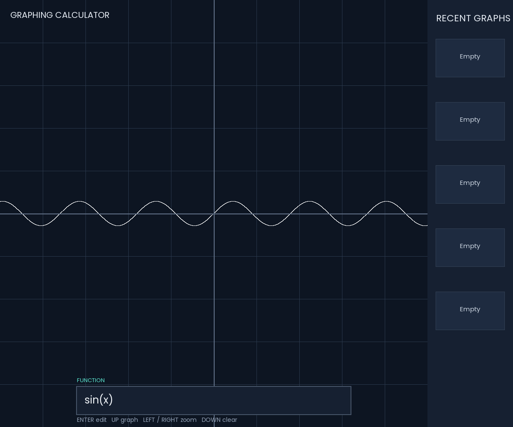

# SFML Graphing Calculator

This project is a desktop graphing calculator written in C++17 with SFML 2.
It tokenizes a mathematical expression, converts infix notation to postfix notation, evaluates the result with reverse Polish notation, and samples the expression across a visible x range.

I wrote the first version in 2023 while learning C++ and modernized it in 2026.
The [`original-2023`](https://github.com/hskl18/Graphing_Calculator_SFML/tree/original-2023) tag keeps the first version.



## Features

- Graphs expressions containing the variable `x`.
- Supports `+`, `-`, `*`, `/`, and `^` with parentheses and a real unary minus operator.
- Supports `sin`, `cos`, `tan`, `cot`, `sec`, `csc`, inverse trigonometric functions, hyperbolic functions, `ln`, `log`, `abs`, `min`, and `max`.
- Keeps the five most recent valid expressions in an LRU history sidebar.
- Provides keyboard zoom controls and mouse-selectable history entries.
- Exposes a headless `ExpressionEvaluator` interface for deterministic tests without a display server.

## Architecture

<picture>
  <source media="(prefers-color-scheme: dark)" srcset="docs/architecture-dark.svg">
  
</picture>

| Component | Responsibility |
| --- | --- |
| `includes/tokenizer` | Splits expression text into typed tokens. |
| `includes/lib/shunting_yard` | Converts infix tokens to postfix order. |
| `includes/lib/rpn` | Evaluates postfix tokens for a supplied value of `x`. |
| `includes/evaluator` | Provides a small headless API around tokenization and evaluation. |
| `includes/plot` | Samples evaluated points and converts them to SFML vertices. |
| `includes/engine` | Owns the window loop, keyboard input, zoom state, and rendering. |
| `includes/lib/lru` | Stores recent valid expressions for the history sidebar. |

The exact grammar, ownership model, asset path, and evidence boundaries are documented in [DESIGN.md](DESIGN.md).

## Requirements

- CMake 3.20 or newer.
- A compiler with C++17 support.
- SFML 2.5 or 2.6 with the graphics, window, and system components.

### macOS

Install the native Homebrew SFML 2 formula.
The formula is keg-only, so pass its prefix to CMake.

```bash
brew install sfml@2
cmake -S . -B build \
  -DCMAKE_BUILD_TYPE=Release \
  -DCMAKE_PREFIX_PATH="$(brew --prefix sfml@2)"
```

### Ubuntu

```bash
sudo apt-get update
sudo apt-get install -y cmake g++ libsfml-dev
cmake -S . -B build -DCMAKE_BUILD_TYPE=Release
```

## Build and run

```bash
cmake --build build --parallel
./build/graphing_calculator
```

Runtime assets are copied beside the executable, so the application can launch from any working directory and the source checkout does not need to remain at its original path.

To create a relocatable local install directory:

```bash
cmake --install build --prefix dist
./dist/graphing_calculator
```

## Controls

- Press `Enter` to select the expression input.
- Press `Escape` to leave the expression input.
- Press `Up` to graph the current expression.
- Press `Down` to clear the graph and error state.
- Press `Right` to zoom in.
- Press `Left` to zoom out.
- Click a history entry to restore its expression and graph.

## Test

```bash
ctest --test-dir build --output-on-failure
```

The headless suites verify the complete documented function set, strict numbers, precedence, variables, unary minus, function arity, invalid adjacency, delimiters, non-finite results, and LRU eviction behavior.
CI compiles the full SFML application on Ubuntu and runs the same suites, including a packaged-resource smoke.

To graph the startup expression and check history recovery on Linux without a display:

```bash
xvfb-run -a ./build/graphing_calculator --smoke-test
```

To work only on the evaluator without installing SFML, disable the desktop target.

```bash
cmake -S . -B build-core \
  -DGRAPHING_CALCULATOR_BUILD_APP=OFF \
  -DBUILD_TESTING=ON
cmake --build build-core --parallel
ctest --test-dir build-core --output-on-failure
```

## Expression grammar

- Accepted number forms include `1`, `1.`, `.5`, and `1.5`.
- Functions require parentheses.
- `min` and `max` require exactly two comma-separated arguments.
- Unary minus supports values, variables, groups, and functions.
- Unary minus binds below exponentiation, so `-2^2` is `-4` while `(-2)^2` is `4`.
- Implicit multiplication is not supported.
- Scientific notation is not supported.

Malformed numbers, wrong function arity, repeated commas, invalid adjacency, and unmatched delimiters fail closed.

## Asset license

The packaged Poppins Regular font is distributed under the SIL Open Font License 1.1.
Its license and provenance are recorded in [`assets/THIRD_PARTY_NOTICES.md`](assets/THIRD_PARTY_NOTICES.md).
Decorative UI graphics are drawn with SFML shapes rather than redistributed image assets.

## Limitations

This is an educational graphing calculator rather than a computer algebra system.
It supports one variable, uses floating-point evaluation, and samples points at a fixed interval.
It does not perform symbolic simplification, equation solving, discontinuity detection, implicit multiplication, or export to image and data formats.
The automated suite validates the evaluator, plotting bounds, ownership, LRU behavior, startup graph, history-based error recovery, full application build, and packaged font loading but does not automate complete pointer interaction or pixel-level rendering.

## License

This project is available under the [MIT License](LICENSE).
